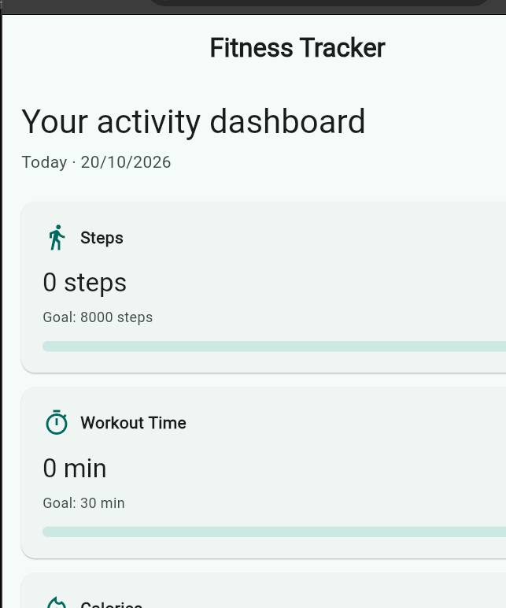

# Fitness Tracker

**A simple, privacy-conscious personal activity log built in Flutter.** Record workouts manually, understand daily progress and review recent activity trends.

[](https://github.com/Fafali1234557/codealpha_tasks/actions/workflows/flutter-tests.yml)


> **Internship project:** CodeAlpha App Development · Fitness Tracker  
> **Developer:** **Saviour Fafali Ankugah** · [LinkedIn](https://www.linkedin.com/in/saviour-ankugah-001b04361/) · [Portfolio](https://saviour-dev.netlify.app/) · [GitHub](https://github.com/Fafali1234557)  
> [← Back to the project collection](../README.md)

## App preview



*Authentic screenshot from the Flutter application running locally in Chrome, October 20, 2026.*

## The problem

People who track their workouts manually need a clear record of what they did, how long it took and how their activity changes through the week. This app brings daily totals, editable entries and a seven-day overview into one lightweight dashboard.

## Features

- **Manual activity logging:** Record workout type, date, steps, minutes and calories.
- **Daily dashboard:** See totals and progress toward example step, exercise-duration and calorie goals.
- **Seven-day overview:** Review recent activity and a weekly chart of steps, with weekly summary totals.
- **History management:** Browse earlier records, edit them or delete entries after confirmation.
- **Date selection and validation:** Choose activity dates and prevent invalid or all-zero activity submissions.
- **Offline local storage:** JSON activity records persist using `shared_preferences`.
- **Adaptive layout:** Material 3 components accommodate narrow phones and wider displays.

## Technology and implementation

| Technology | Purpose |
| --- | --- |
| Flutter / Dart | UI, layout and interactions |
| StatefulWidget / setState | Dashboard updates |
| shared_preferences + dart:convert | Local JSON serialization and persistence |
| Flutter material widgets | Forms, dialog, progress indicators and charts |
| flutter_test | Activity serialization, validation and persistence tests |
| GitHub Actions | Automated quality checks |

The `Activity` model describes a single logged session. The app calculates summaries from its locally stored activity list and updates the dashboard after entries are added, edited or deleted.

## Getting started

Install [Flutter](https://docs.flutter.dev/get-started/install), then:

```bash
git clone https://github.com/Fafali1234557/codealpha_tasks.git
cd codealpha_tasks/CodeAlpha_FitnessTracker
flutter pub get
flutter run
```

To run using Chrome: `flutter run -d chrome`.

## Test and verify

```bash
flutter analyze
flutter test
```

Widget and model tests cover an `Activity` JSON round-trip, saving and restoring a logged activity, and rejecting an all-zero entry. Results: [GitHub CI](https://github.com/Fafali1234557/codealpha_tasks/actions).

Suggested manual test: add a walking activity, inspect today's totals, edit it, restart the app and check whether the entry remains.

## Project structure

```text
CodeAlpha_FitnessTracker/
├── lib/main.dart          # Activity model, dashboard and forms
├── test/widget_test.dart   # Automated tests
├── pubspec.yaml            # Flutter dependencies
├── android/ ios/ web/     # Platform-specific files
└── README.md
```

## Important scope and limitations

- **Not a live pedometer:** Steps, calories and exercise time must be entered manually. Phone motion sensors are not integrated.
- **Not medical software:** Calorie values are supplied by the user; the goals are example defaults, not personalized advice.
- **Local prototype:** `shared_preferences` is sufficient for this demo, but a production activity journal should use a stronger database and improved backup/export options.

## What this project demonstrates

User-centered dashboard design, data validation, local data persistence, serialization, CRUD-style interactions, basic charting and practical automated testing.

---

Part of my [CodeAlpha App Development portfolio](https://github.com/Fafali1234557/codealpha_tasks).  
### Developer

**Saviour Fafali Ankugah** — [LinkedIn](https://www.linkedin.com/in/saviour-ankugah-001b04361/) · [Portfolio](https://saviour-dev.netlify.app/) · [GitHub](https://github.com/Fafali1234557)

<!-- Demo-video link and professional contact email can be added when provided. -->
