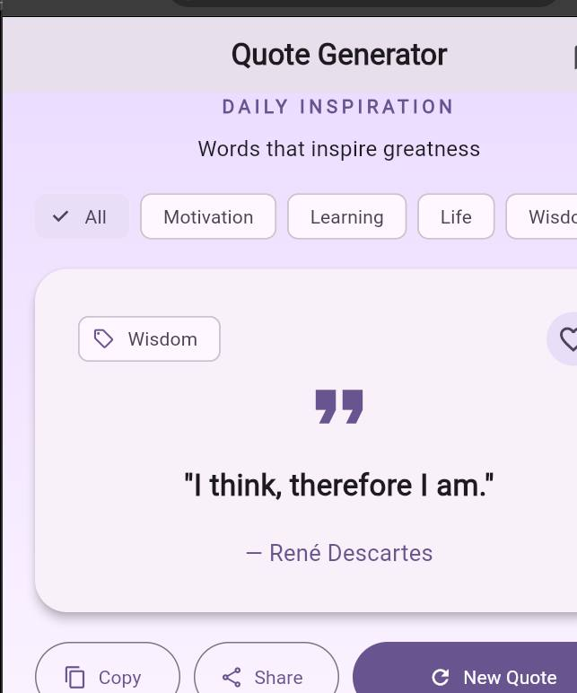

# Random Quote Generator

**A thoughtful daily-inspiration app with favorites and sharing.** Explore quotes, discover new ideas, and keep meaningful lines for later in a clean Flutter interface.

[](https://github.com/Fafali1234557/codealpha_tasks/actions/workflows/flutter-tests.yml)


> **Internship project:** CodeAlpha App Development · Random Quote Generator  
> **Developer:** **Saviour Fafali Ankugah** · [LinkedIn](https://www.linkedin.com/in/saviour-ankugah-001b04361/) · [Portfolio](https://saviour-dev.netlify.app/) · [GitHub](https://github.com/Fafali1234557)  
> [← Back to the project collection](../README.md)

## App preview



*Authentic screenshot from the Flutter application running locally in Chrome, October 20, 2026.*

## The problem

A quote should be easy to discover, save and share—not buried in a long list. This app surfaces a random quote and makes it simple to browse by interest, revisit favorites and share text with others.

## Features

- **Random quote on launch:** Opens to a randomly chosen quote with its author.
- **New Quote:** Chooses another quote without immediately repeating the current one.
- **Category filters:** Browse Motivation, Learning, Life, and Wisdom.
- **Save favorites:** Add or remove favorite quotes and revisit them from the saved-quotes view.
- **Copy and share:** Copy a quote with author attribution or launch device sharing through `share_plus`.
- **Light and dark themes:** Theme preferences and favorite selections persist locally.
- **Responsive design:** Material 3 widgets, adaptable spacing and animated quote changes.

## Technology and architecture

| Technology | How it is used |
| --- | --- |
| Flutter and Dart | Responsive cross-platform UI and state |
| dart:math | Random quote selection |
| shared_preferences | On-device favorites and theme preferences |
| share_plus / Clipboard | Native sharing and copy interactions |
| flutter_test | Widget tests for quote rotation and saved preferences |
| GitHub Actions | Automated analysis and test execution |

**Implementation:** A typed `Quote` model represents quote text, author and category. The interface and presentation logic live in `lib/main.dart`; preferences are saved on-device rather than sent to a remote service.

## Run locally

Install [Flutter](https://docs.flutter.dev/get-started/install), then:

```bash
git clone https://github.com/Fafali1234557/codealpha_tasks.git
cd codealpha_tasks/CodeAlpha_RandomQuoteGenerator
flutter pub get
flutter run
```

For browser testing use `flutter run -d chrome`. For a connected phone use `flutter devices` and select its device ID.

## Tests

```bash
flutter analyze
flutter test
```

The automated tests cover showing a quote and author, switching quotes, favorite persistence and theme persistence. Review the [CI results](https://github.com/Fafali1234557/codealpha_tasks/actions).

## Repository layout

```text
CodeAlpha_RandomQuoteGenerator/
├── lib/main.dart          # Model, UI, quote logic and preferences
├── test/widget_test.dart   # Automated Flutter widget tests
├── pubspec.yaml            # Dependencies
├── android/ ios/ web/     # Platform setup
└── README.md
```

## Limitations and future work

- Quotes are bundled into the application rather than fetched from a remote API.
- Favorites and theme preferences are stored **only on the current device/browser**; no account or cloud sync is implemented.
- Offline browsing is supported for bundled quotes; platform sharing behavior depends on the device's available share targets.
- Future enhancements could include search, a daily reminder and accessible font-size controls.

## What this project demonstrates

Typed modeling, randomness with no immediate repeat, filtering, responsive UI, native integrations, local persistence and testable Flutter interactions.

---

Part of my [CodeAlpha App Development portfolio](https://github.com/Fafali1234557/codealpha_tasks).  
### Developer

**Saviour Fafali Ankugah** — [LinkedIn](https://www.linkedin.com/in/saviour-ankugah-001b04361/) · [Portfolio](https://saviour-dev.netlify.app/) · [GitHub](https://github.com/Fafali1234557)

<!-- Demo-video link and professional contact email can be added when provided. -->
