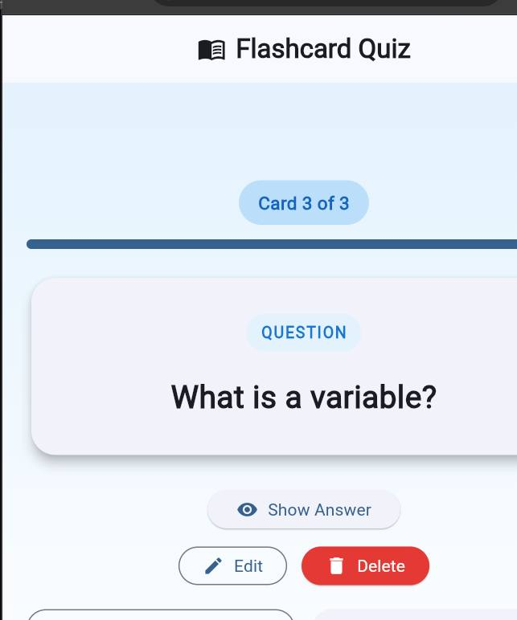

# CodeAlpha · App Development Internship

**Three Flutter applications focused on learning, inspiration and personal activity tracking.** Each app is a self-contained project with native Flutter platform files, setup instructions and automated tests.

[](https://github.com/Fafali1234557/codealpha_tasks/actions/workflows/flutter-tests.yml)


**Developer:** **Saviour Fafali Ankugah** · [LinkedIn](https://www.linkedin.com/in/saviour-ankugah-001b04361/) · [Portfolio](https://saviour-dev.netlify.app/) · [GitHub](https://github.com/Fafali1234557) · **Internship track:** App Development · **Framework:** Flutter / Dart

## Featured applications

| Project | Built to solve | Highlights |
| --- | --- | --- |
| [**Flashcard Quiz App**](CodeAlpha_FlashcardQuizApp/) | Help learners practice active recall | Reveal answers, Next/Previous, create/edit/delete, validation and progress indicator |
| [**Random Quote Generator**](CodeAlpha_RandomQuoteGenerator/) | Make inspiration easy to discover and revisit | Random quotes, category filters, copy/share, favorites and dark mode |
| [**Fitness Tracker**](CodeAlpha_FitnessTracker/) | Make daily workout records easier to review | Manual activity logging, editable history, daily goals, seven-day progress and local persistence |

Each link opens a **recruiter-ready project README** with feature explanations, technical choices, quick-start steps, test instructions and current limitations.

## Screenshots from the working applications

These are screenshots from the actual Flutter applications running locally in Chrome (October 20, 2026), not generated mockups.

| Flashcard Quiz | Random Quote Generator | Fitness Tracker |
| :---: | :---: | :---: |
| [](CodeAlpha_FlashcardQuizApp/) | [](CodeAlpha_RandomQuoteGenerator/) | [](CodeAlpha_FitnessTracker/) |

## Engineering approach

- **Flutter + Dart:** Interactive UI and application logic using Material 3 components.
- **State management:** Clear, small-scale `StatefulWidget` and `setState` implementations suited to these prototype scopes.
- **Persistence where needed:** `shared_preferences` stores quote preferences and manual fitness activity records. Flashcards currently remain in memory.
- **Product thinking:** Validation, actionable UI feedback and straightforward navigation.
- **Quality checks:** Individual widget tests plus automated `flutter analyze` and `flutter test` runs on GitHub Actions.

## Try the projects

Install [Flutter](https://docs.flutter.dev/get-started/install) and clone this repository:

```bash
git clone https://github.com/Fafali1234557/codealpha_tasks.git
cd codealpha_tasks
```

Open **one** of the following folders in a terminal:

```text
CodeAlpha_FlashcardQuizApp
CodeAlpha_RandomQuoteGenerator
CodeAlpha_FitnessTracker
```

From inside that folder:

```bash
flutter pub get
flutter analyze
flutter test
flutter run
```

The apps include Android, iOS, web and desktop project scaffolding; building a specific platform still requires the relevant Flutter toolchain. Passing CI means the source analysis and automated tests succeeded, **not** that app-store releases or phone installation were verified.

## Project directory

```text
codealpha_tasks/
├── CodeAlpha_FlashcardQuizApp/
│   ├── lib/  test/  android/  ios/  web/  ...
│   └── README.md
├── CodeAlpha_RandomQuoteGenerator/
│   ├── lib/  test/  android/  ios/  web/  ...
│   └── README.md
├── CodeAlpha_FitnessTracker/
│   ├── lib/  test/  android/  ios/  web/  ...
│   └── README.md
├── .github/workflows/flutter-tests.yml
├── CODEALPHA_APP_DEVELOPMENT_FORM.md
├── SUBMISSION.md
└── README.md
```

## Continuous integration

The [Flutter CI workflow](.github/workflows/flutter-tests.yml) tests all three independent Flutter packages on every push to `main`. See [workflow runs](https://github.com/Fafali1234557/codealpha_tasks/actions) for the most recent status.

## Internship submission

- [Submission checklist](SUBMISSION.md)
- [Form-ready details and links](CODEALPHA_APP_DEVELOPMENT_FORM.md)

These are project assets, not proof that CodeAlpha's external submission form has been completed.

## About the developer

**Saviour Fafali Ankugah** · [LinkedIn](https://www.linkedin.com/in/saviour-ankugah-001b04361/) · [Developer portfolio](https://saviour-dev.netlify.app/) · [GitHub](https://github.com/Fafali1234557)

I am building practical Flutter applications while learning to design user-friendly experiences, validate input, manage local state and ship tested source code. More work: [GitHub profile](https://github.com/Fafali1234557).

<!-- Optional future additions: a public professional contact email and uploaded demonstration videos, if provided. -->
